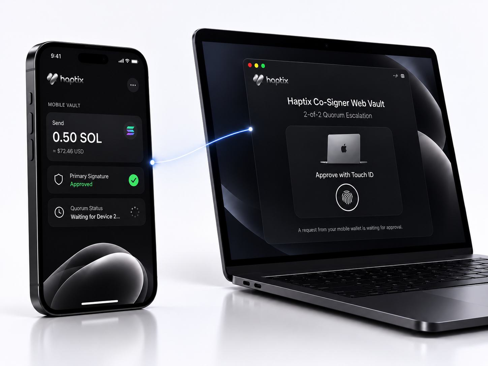
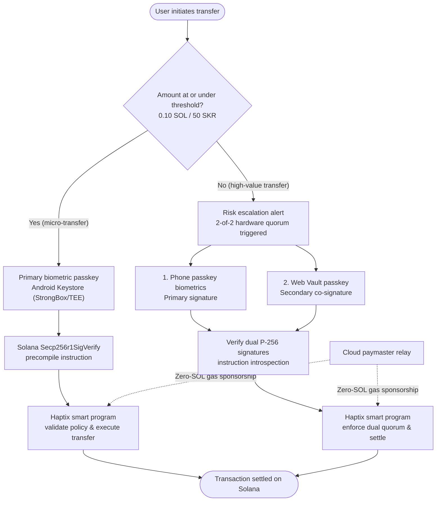

<div align="center">

<picture>
  <source media="(prefers-color-scheme: dark)" srcset="public/assets/logotext-dark.png">
  <source media="(prefers-color-scheme: light)" srcset="public/assets/logotext-light.png">
  
</picture>

<br /><br />

**Seedless. Biometric-Secured. Agent-Ready.**  
*Built specifically for the **Solana Mobile CLOCK IN Hackathon** &bull; Dedicated to **Solana Seeker***

[-00FF66?style=flat&logo=solana)](https://solanamobile.radiant.nexus)
[](https://solanamobile.com)
[](https://publish.solanamobile.com)
[](https://github.com/ritesh59697/haptix-mobile-app/actions/workflows/ci.yml)
[](tests/)
[](LICENSE)

<br />

[Website](https://haptixwallet.xyz) &middot; [Download APK (v1.0.2)](https://github.com/ritesh59697/haptix-mobile-app/releases/download/v1.0.2/haptix-wallet.apk) &middot; [Web Vault (Co-Signer)](https://haptixwallet.xyz/vault.html) &middot; [Recovery Portal](https://haptixwallet.xyz/recover.html) &middot; [Pitch Video (70s)](https://youtu.be/9OnEFuHqNDY) &middot; [Devnet Program](https://explorer.solana.com/address/9wC1ok8d4PrBDG3TS7iyEu9QxMCYv6BKrdLb3q4yZbke?cluster=devnet)

</div>

---

## Hackathon Deliverables

| Deliverable | Details & Links |
| :--- | :--- |
| **Track & Target** | Solana Mobile CLOCK IN Hackathon &bull; Dedicated to **Solana Seeker (Chapter 2)** |
| **Solana dApp Store** | **Live & Published (v1.0.2 / Build 3)** &bull; Submission ID: `#344280197850` &bull; Package: `io.haptix.wallet` &bull; [Solana Mobile Publishing Portal](https://publish.solanamobile.com)<br />*Note: Published on the Solana dApp Store catalog (accessible on Solana Seeker/Saga devices). The portal link requires a publisher login; no public web listing URL is currently provided by the dApp Store. Smart contracts execute on Solana Devnet.* |
| **Android APK** | [**Download haptix-wallet.apk (v1.0.2)**](https://github.com/ritesh59697/haptix-mobile-app/releases/download/v1.0.2/haptix-wallet.apk) &bull; EAS Build ID: [`d1a7544a`](https://expo.dev/accounts/ritesh5969/projects/haptix-wallet/builds/d1a7544a-1f49-47dc-a1c3-94c4be3ac105) &bull; Version Code: `3`<br />*Store compliance: Zero-config devnet gas auto-funding for reviewers (FUN-002) and minimal Android permissions (PER-001).* |
| **Recovery Guide** | [**Visual Guardian Recovery Guide**](docs/GUARDIAN_RECOVERY_GUIDE.md) &bull; On-chain lifecycle, timelock & veto walkthrough |
| **Live Web Demos** | [**haptixwallet.xyz**](https://haptixwallet.xyz) (Primary) &bull; [**Web Vault (Co-Signer)**](https://haptixwallet.xyz/vault.html) &bull; [**Recovery Portal**](https://haptixwallet.xyz/recover.html) &bull; *(Fallback: [haptix-passkeys.vercel.app](https://haptix-passkeys.vercel.app))* |
| **Video Demos** | [**70-Second Pitch**](https://youtu.be/9OnEFuHqNDY) &bull; [**3-Minute Technical Walkthrough**](https://youtu.be/kNsqykt4rfg) |
| **Pitch Deck & Docs** | [**Haptix_Pitch_Deck.pdf**](https://github.com/ritesh59697/haptix-mobile-app/releases/download/v1.0.1/Haptix_Pitch_Deck.pdf) &bull; [**Documentation**](https://docs.haptixwallet.xyz) |
| **On-Chain Program** | [`9wC1ok8d4PrBDG3TS7iyEu9QxMCYv6BKrdLb3q4yZbke`](https://explorer.solana.com/address/9wC1ok8d4PrBDG3TS7iyEu9QxMCYv6BKrdLb3q4yZbke?cluster=devnet) on Solana Devnet |
| **Test Verification** | **324 automated tests passing** across 14 suites (`npm test` with Devnet funder key) &bull; **262 tests without keys** (`npm run test:no-key`: no private key required; makes read-only calls to public devnet RPC) |
| **Cloud Paymaster** | [https://haptix-relay.onrender.com](https://haptix-relay.onrender.com) (Gas sponsorship relay &bull; *Render free tier*) |

---

## Overview

Haptix is a risk-adaptive passkey smart wallet built natively for the Solana Mobile Stack (SMS) and the Solana Seeker (Chapter 2):

1. **Hardware-Backed Passkey Biometrics**: Integrates Android Credential Manager and the Secp256r1 hardware curve (`react-native-passkey`) for seedless, 1-tap biometric authentication backed by Android Keystore (StrongBox/TEE).
2. **Risk-Adaptive Spend Escalation**: Transfers &le; 0.10 SOL (or &le; 50 SKR) authorize instantly via single-tap phone biometrics. High-value transfers exceeding the threshold automatically escalate to require a 2-of-2 dual-device hardware quorum (mobile phone passkey + secondary Web Vault passkey).
3. **On-Chain Cryptographic Verification**: Signature verification and spending limits are enforced directly on-chain via Solana's native `Secp256r1SigVerify` precompile with instruction introspection. The passkey-signed payload explicitly commits to the recipient and transfer amount, preventing the paymaster or relay from diverting funds or modifying amounts. (Note: While a relay cannot alter or forge transactions, it can still delay or refuse to submit them.)
4. **Autonomous Agent Sessions**: Grants temporary, expenditure-capped session keys for automated agent interactions and swaps without triggering repetitive biometric prompts.
5. **Guardian Social Recovery & Panic Freeze**: Non-custodial 24-hour timelock recovery portal ([`recover.html`](https://haptixwallet.xyz/recover.html)) with instant on-chain panic freeze and owner 2-of-2 veto capabilities.

<br />

<div align="center">
  
  <p><em>Risk-Adaptive Spend Escalation: 1-Tap Biometrics under 0.10 SOL, escalating to a 2-of-2 Hardware Quorum (Mobile + Web Vault) above threshold.</em></p>
</div>

---

### Signing & Policy Verification Flow



---

## Status & Operational Notes

- **Network Environment**: The smart contracts are deployed and verified on **Solana Devnet**. The mobile APK is published via the Solana Mobile Publishing Portal for catalog distribution, but all on-chain logic currently targets Devnet. Devnet tokens have no real value.
- **Security Audit Status**: The on-chain Anchor program and client cryptographic libraries are experimental hackathon implementations and have **not yet been audited** by a third-party security firm.
- **Paymaster Relay Infrastructure**: The zero-SOL gasless paymaster is hosted on Render's free tier. If the relay service has been idle, the initial request may experience a **30–50 second cold-start delay** while the container spins up. Subsequent transactions are typically fast once warm.
- **Hardware Passkey Support**: Android Credential Manager passkey signing relies on hardware-backed keystores (StrongBox/TEE). Hardware-backed key behavior cannot be verified on emulators, and Expo Go does not support custom native passkey modules; testing requires a physical Android device (Seeker, Saga, Pixel, Galaxy running Android 9+).
- **Devnet Fee-Funder Key**: Preview builds ship a devnet-only fee-funder key (`EXPO_PUBLIC_*`) so reviewers get zero-config gas. It is a throwaway devnet keypair with no authority over any user wallet. Production builds (DEV_MODE=false) must not include it.

---

## Repository Architecture

```
haptix-mobile-app/
├── app/                            # Expo Router file-based navigation
│   ├── (tabs)/                     # Main authenticated tab views
│   │   ├── index.tsx               # Smart wallet dashboard & navigation
│   │   └── settings/               # Spending limits, recovery, security
│   ├── sign-in.tsx                 # Onboarding & passkey registration
│   └── _layout.tsx                 # Root layout & providers
├── components/                     # UI design system components
│   ├── haptix/                     # Haptix brand components & wallet views
│   │   ├── haptix-wallet-screen.tsx# Main wallet dashboard & expanded send
│   │   ├── haptix-floating-dock.tsx# Floating dock navigation
│   │   └── haptix-icons.tsx        # Vector icon library (Lucide / Rune)
│   └── ui/                         # Reusable animated components
├── public/                         # Web applications & static assets
│   ├── index.html                  # Official landing page, threat models & FAQ
│   ├── vault.html                  # Live Web Vault (2-of-2 hardware multisig client)
│   ├── recover.html                # Social Guardian timelock recovery web portal (Live)
│   └── assets/                     # Brand graphics, vector marks & media
├── utils/                          # Cryptography, PDA derivation & RPC clients
│   ├── haptix-passkey.ts           # Secp256r1 hardware passkey signing
│   ├── haptix-client.ts            # Anchor instruction builder & account parser
│   └── secp256r1-instruction.ts    # Native Secp256r1 precompile serializer
├── tests/                          # 14-suite automated integration test harness
│
└── haptix_program/                 # On-Chain Anchor 0.31 Solana Smart Contract
    ├── programs/haptix_program/    # Rust program implementation
    │   └── src/
    │       ├── instructions/       # Transfer, Quorum, Agent, Recovery instructions
    │       ├── secp256r1.rs        # Precompile instruction introspection
    │       ├── state/              # Wallet account layout & spend policies
    │       └── lib.rs              # Program entrypoint
    ├── tests/                      # Anchor integration test suite
    └── Anchor.toml                 # Anchor configuration & Devnet deployment
```

---

## Quick Start

### Prerequisites
- **Node.js**: Node 20+ (CI and EAS use `22.14.0`) &bull; **Rust**: 1.75+ (tested on `rustc 1.95.0`)
- **Solana / Agave CLI**: Solana/Agave CLI 2.x or newer (tested on `3.1.13`)
- **Anchor**: Anchor 0.31.1
- **Android Environment**: Android Studio with Android SDK (API 34/35) and **JDK 17** (required for `npx expo run:android`).
- **Target Device**: Physical Android device (Android 9+ / API 28+) with biometric screen lock (or Solana Seeker / Saga). Hardware-backed keystore behavior cannot be verified on standard emulators.
- **Environment Configuration**:
  ```bash
  cp .env.example .env
  ```
  `EXPO_PUBLIC_HAPTIX_DEV_MODE=true` is pre-configured in preview builds for fee sponsorship and devnet faucet drip. Set `EXPO_PUBLIC_HAPTIX_DEVNET_RPC_URL` to a dedicated RPC to avoid public rate-limits.

### Mobile App
```bash
# 1. Install dependencies
npm install

# 2. Run test suite without private keys (12 suites, 262 assertions; no private key required; makes read-only calls to public devnet RPC)
npm run test:no-key

# 3. Or run the full test suite including live Devnet on-chain execution (14 suites, 324 assertions)
npm test

# 4. Start Expo development server (for native dev client)
npx expo start

# 5. Build standalone Android APK with EAS
npx eas-cli build -p android --profile preview
```

### Smart Program (`haptix_program`)
- **Program ID**: `9wC1ok8d4PrBDG3TS7iyEu9QxMCYv6BKrdLb3q4yZbke` (Solana Devnet)
- **Precompile**: `Secp256r1SigVerify1111111111111111111111111`

```bash
cd haptix_program
anchor build
anchor test
```

---

## Automated Test Suite (324 Total &bull; 262 Without Keys)

The cryptographic pipeline, on-chain program, and spend policies are verified by an automated integration test harness (324 assertions across 14 suites with a funded Devnet key, or 262 assertions across 12 suites with no private key required):

```bash
# Run the 12 suites that require no private key (262 assertions; makes read-only calls to public devnet RPC)
npm run test:no-key

# Run all 14 suites including live Devnet on-chain execution (324 assertions)
npm test
```

- **Cryptography & Precompile**: Secp256r1 signature encoding, low-S canonical form, instruction introspection offsets.
- **On-Chain Policies**: Spend threshold escalation, 2-of-2 hardware quorum, and Seeker SKR token rules.
- **Social Recovery**: 24-hour timelock execution, guardian authorization, and owner veto on live Solana Devnet.

> **Note on Devnet tests**: The two on-chain suites (`recovery-devnet.test.ts` and `set-spend-threshold.test.ts`, totaling 62 assertions) execute live transactions against Solana Devnet and will exit with an error if `EXPO_PUBLIC_HAPTIX_FUNDER_KEY` is not set or lacks > 0.5 Devnet SOL for rent. To run tests without any funder key, use `npm run test:no-key` (12 suites, 262 passing assertions; no private key required; makes read-only calls to public devnet RPC).

---

## Design Principles

- **Minimalist Monochrome**: Precision typography, dark tones, and subtle hairline borders—no neon or generic cliches.
- **Physical Haptics**: Tactile feedback on navigation, percentage chips, and biometric passkey authorization.
- **Monospace Geometry**: Tabular figures and rolling counters to prevent jarring layout jumps.

---

## License

This project is open-source and licensed under the [MIT License](LICENSE).

---

Built by [Ritesh](https://x.com/Ritesh5969) &bull; Follow [@HaptixWalllet](https://x.com/HaptixWalllet)
