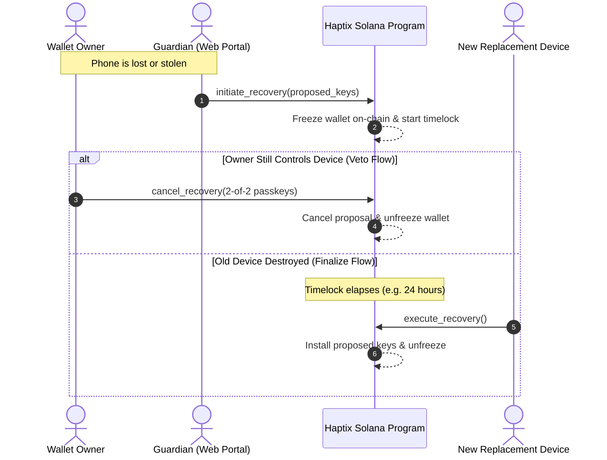
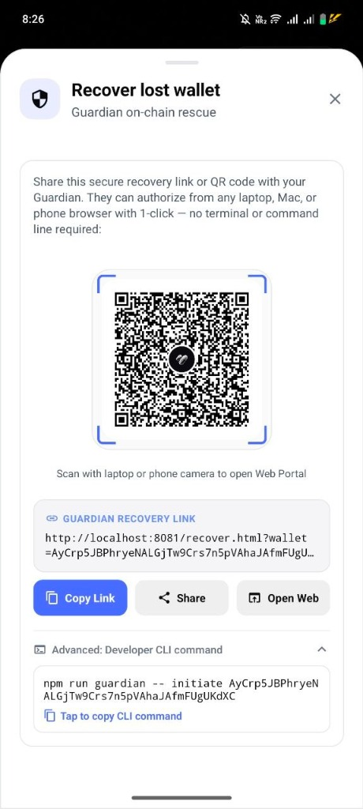
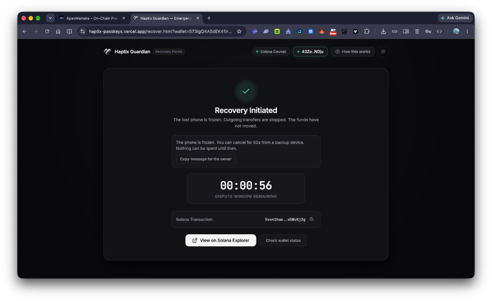
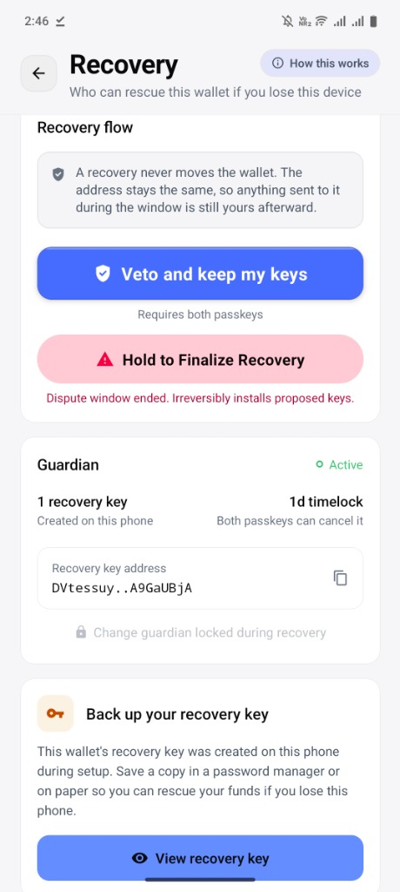
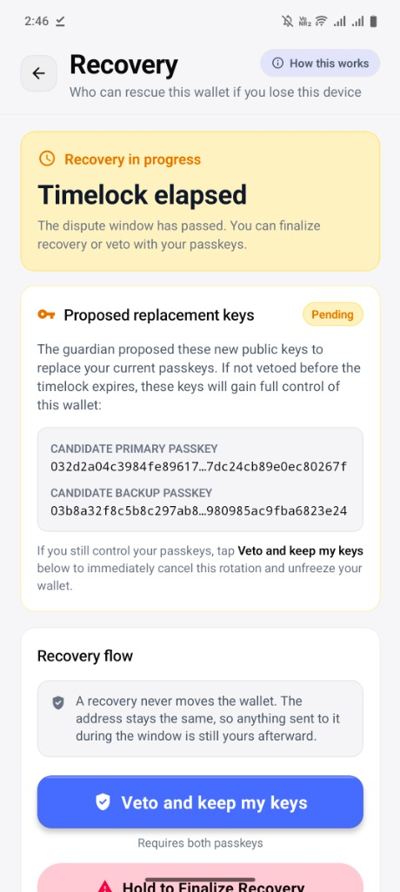

# Haptix Guardian Social Recovery — Visual User & Architecture Guide

> **Seedless. Biometric-Secured. Non-Custodial.**  
> *How Haptix protects your funds when your phone is lost, stolen, or destroyed—without ever exposing your wallet to guardian theft.*

---

## 1. Why Recovery Matters (The Seedless Dilemma)

Traditional crypto wallets force users to write down a **12-word seed phrase**. If they lose their phone, they restore the wallet by typing the seed phrase on a new device. However, seed phrases are the single largest source of hacks, phishing scams, and permanent balance loss in Web3.

Haptix is **100% seedless**: your private keys are non-exportable hardware credentials stored inside the physical chip of your phone (**Android StrongBox / Apple Secure Enclave**). 

**The fundamental security question:**  
*If you drop your phone in the ocean, how do you recover your funds without a seed phrase?*

**The Haptix solution:**  
An on-chain **Asymmetric Guardian Recovery Engine** enforced directly by the [`haptix_program`](../haptix_program) Solana smart contract.

---

## 2. Core Security Axiom: Asymmetric Power

The bedrock rule of Haptix recovery is **asymmetric authority**:

> **A guardian can START an emergency freeze, but can NEVER steal funds or finish a recovery if the owner vetos.**

| Role | Action | Cryptographic Requirement |
| :--- | :--- | :--- |
| **Recovery Guardian** | Initiate freeze & propose new keys | Guardian signature alone |
| **Wallet Owner** | **Veto & cancel recovery** | **2-of-2 Hardware Passkeys (Biometric)** |
| **Anyone / New Phone** | Finalize & rotate keys | **Zero signatures — gated ONLY by on-chain timelock** |

---

## 3. The 4-Stage Recovery Lifecycle

---

### Stage 1: Setup & Sharing Recovery Link

During setup or from **Settings → Recovery**, the wallet displays the dedicated **Guardian on-chain rescue** card:

  
  
<i>The app generates a unique Guardian Recovery Link and QR code targeting the live web portal.</i>

- **Direct Web Link**: `https://haptix-passkeys.vercel.app/recover.html?wallet=<WALLET_PDA>`
- **No Command Line Required**: Anyone with a standard laptop, tablet, or phone browser can act as your guardian.

---

### Stage 2: Emergency Freeze via Web Portal

If your phone is lost or stolen, your Guardian opens the [Emergency Recovery Portal](https://haptix-passkeys.vercel.app/recover.html) from any browser (Mac, Windows, or phone):

  
  
<i>The Guardian connects their wallet (Phantom, Solflare, etc.) and freezes the account on-chain.</i>

1. Guardian connects their wallet (`Phantom`, `Solflare`, `Backpack`, etc.).
2. The portal checks on-chain state to confirm the guardian key matches.
3. Guardian clicks **"Freeze lost phone"**.
4. **On-Chain Effect**:
   - Outgoing transfers from the stolen device are **immediately blocked**.
   - Proposed replacement passkeys are staged on-chain.
   - An on-chain countdown timer (**Dispute Window**) begins.
   - Funds do **not** move anywhere—they remain safe in the wallet account.

---

### Stage 3: The Owner's Veto ("Keep My Keys")

What if the guardian made a mistake, or a rogue guardian attempted an unauthorized takeover?

  
  
<i>The real owner taps "Veto and keep my keys" to cancel the takeover with hardware biometrics.</i>

- If the owner still controls the phone, the app displays the **Recovery Flow** warning.
- The owner taps **"Veto and keep my keys"** and approves with both hardware passkeys (Touch ID / Face ID).
- **On-Chain Result**: The smart contract instantly invalidates the guardian's proposal, resets the timer, and unfreezes the wallet.
- **Guardian Defense Guarantee**: A rogue guardian can never force a recovery as long as the true owner holds their device.

---

### Stage 4: Timelock Expiration & Final Key Rotation

If the old phone was genuinely destroyed, the owner does not veto. Once the dispute window reaches `00:00:00`:

  
  
<i>Once the timelock expires, candidate keys can be permanently installed onto the new device.</i>

1. The app displays **"Timelock elapsed"** and shows the **Candidate Replacement Passkeys**.
2. On the new device, the user taps **"Hold to Finalize Recovery"**.
3. **On-Chain Execution**:
   - The contract verifies `Clock::get()?.unix_timestamp >= initiated_at + timelock`.
   - The contract rotates the old dead keys and installs the new device's passkeys.
   - The wallet is unfrozen.
   - **Your wallet address, SPL tokens, and SOL balance remain identical!**

---

## 4. Smart Contract Security Invariants

Our on-chain program ([`haptix_program/src/instructions/recovery.rs`](../haptix_program/programs/haptix_program/src/instructions/recovery.rs)) enforces these strict guarantees:

1. **Anti-Griefing Invariant (`ERR_RECOVERY_IN_PROGRESS`)**:
   A guardian cannot perpetually restart the timer or grief the owner. `initiate_recovery` rejects any call if a recovery is already in flight.
2. **Permissionless Execution (`execute_recovery`)**:
   The final installation requires **nobody's signature**—it is gated solely by time. This prevents deadlocks if a guardian becomes unreachable after starting the freeze.
3. **Address Integrity**:
   Because PDA seeds are tied to `[b"haptix_wallet", &primary_passkey[1..33]]`, key rotation updates the authorized signer state without modifying the on-chain account address.
4. **2-of-2 Quorum for Governance**:
   Updating the guardian address (`set_guardian`) requires a full 2-of-2 hardware passkey quorum, preventing malware from secretly replacing your guardian.

---

## 5. Frequently Asked Questions

### Can my guardian steal my money?
**No.** The guardian address has zero spending authority. It can only call `initiate_recovery`, which freezes the wallet. Only your passkeys can authorize transfers.

### What if my guardian loses their wallet?
As long as you have your phone, you can change your guardian at any time under **Settings → Recovery → Change Guardian** (requires 2-of-2 biometric authorization).

### How long is the dispute timelock?
- **Mainnet Standard:** 24 hours (86,400 seconds).
- **Devnet Testing:** 30–60 seconds for fast developer iteration.
